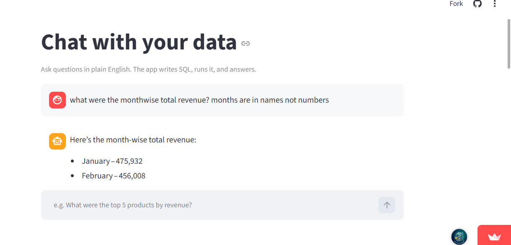

# Chat With Your Data

Ask questions about a dataset in plain English — the app writes SQL, runs it, and answers.

**Live demo:** https://chat-with-your-data-v1.streamlit.app

Built with Python, Streamlit, SQLite and a free LLM API (Groq).

## What it does

- Ask a question like "What were the top 5 products by revenue?"
- The app turns it into SQL, runs it against the data, and explains the result
- It shows the SQL it used and the result table, so you can check the answer

## How it works

question -> LLM writes SQL -> SQLite runs it -> LLM explains the result

## Data

Global Superstore dataset, 51,290 rows.

## Run it locally

python -m venv .venv
.venv\Scripts\activate
pip install -r requirements.txt
python load_data.py superstore.csv superstore
streamlit run app.py

## Tech

Python, Streamlit, SQLite, pandas, Groq
